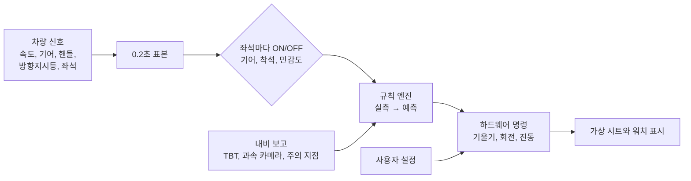

# Active Seat For All

> 내비게이션 경로와 차량 신호로 차의 움직임을 미리 예측하고, 이를 기반으로 차량 시트 또는 웨어러블 기기를 조작하여 동승자의 멀미를 예방 및 완화하는 서비스입니다.

현대자동차그룹 차량용 앱 개발 공모전(Code your App into Pleos App Market) 출품작이며, 팀 이동의즐거움이 만들었습니다.

## 바로 실행하기

### APK

[`apk/이동의즐거움_ActiveSeatForAll_release.apk`](apk/이동의즐거움_ActiveSeatForAll_release.apk)는 서명된 release 빌드입니다. 소스를 빌드하지 않고 바로 설치할 수 있습니다.

### 테스트 환경

| 항목 | 값 |
| --- | --- |
| 에뮬레이터 | Pleos Connect 에뮬레이터 v2.1.0 (Android 14, API 34, x86_64) |
| 차량 상태 입력 | 에뮬레이터에 기본으로 들어 있는 Virtual Console. 앱이 에뮬레이터 안에서 `127.0.0.1:8088`로 직접 호출하므로 따로 설정할 것이 없습니다 |

### 설치와 실행

1. 에뮬레이터를 켠 뒤 APK를 설치합니다.

   ```bash
   adb install -r "apk/이동의즐거움_ActiveSeatForAll_release.apk"
   ```

2. 앱 목록에서 **Active Seat**를 엽니다.
3. 첫 실행 때 권한 창이 뜨면 **권한 허용**을 누르고, 이어서 뜨는 시스템 창에서 허용합니다. 차량 속도 권한이며, 허용하기 전에는 앱을 쓸 수 없습니다.
   - 시스템 권한 창은 기어가 P일 때만 열립니다. 시나리오 재생이 끝나면 기어가 D로 남으므로, 그 뒤에 권한 창이 다시 뜨면 Virtual Console에서 기어를 P로 바꿉니다.
   - "다시 묻지 않음"으로 거부했다면 에뮬레이터 설정에서 허용할 수 없으니, `adb uninstall ai.activeseat.app` 후 다시 설치합니다.
4. 홈에서 **어디로 갈까요?** 또는 별(즐겨찾기) 아이콘을 눌러 시나리오를 고릅니다.
5. 경로 미리보기에서 **안내 시작**을 누릅니다. 판교 시나리오는 그 전에 시연 구간과 전체 경로 중 하나를 고릅니다. 앱이 Virtual Console에 주행을 재생하고, 조수석과 뒷좌석 탭에서 시트와 워치 힌트를 볼 수 있습니다.

재생 중에는 Virtual Console 원래 페이지를 열어 두지 않습니다. 원래 페이지는 페달 값으로 속도를 계속 다시 계산해, 앱이 넣는 주행 값을 덮어씁니다. 재생을 PC 브라우저에서 함께 보려면 콘솔 프록시를 띄우고 http://127.0.0.1:18089 를 엽니다. 프록시는 페달을 밟을 때만 이 계산이 돌게 바꾼 페이지입니다.

```bash
adb forward tcp:18088 tcp:8088
```

```bash
node tools/console-proxy.js
```

## 왜 만들었나

뒷좌석에서 책이나 영상을 보다가 멀미 때문에 내려놓은 경험은 흔합니다. 그런데 운전자는 좀처럼 멀미를 하지 않습니다. 운전자는 차가 어디로 움직일지 미리 알지만, 동승자는 몸이 흔들린 뒤에야 알기 때문입니다. 이렇게 몸이 예상한 것과 실제로 느낀 것이 어긋나는 감각불일치가 멀미의 대표적인 원인으로 꼽힙니다.

- 동승자에게 움직임을 미리 알려 주면 멀미가 줄어듭니다. 테스트 트랙 실험에서 진동으로 차의 움직임을 예고하자 멀미 증상이 약 40% 줄었습니다(Reuten 외, 2024).
- 자율주행은 멀미를 더 심하게 만들 수 있습니다(Diels & Bos, 2016). 운전석에 앉은 사람도 동승자가 되면, 차가 어디로 움직일지 미리 아는 사람이 아무도 없게 됩니다.

이 앱은 운전자만 알던 "미리 앎"을 동승자에게 나눠 줍니다. 내비가 이미 알고 있는 다음 회전과 감속 지점을 써서, 차가 움직이기 **전에** 시트와 워치로 알립니다.

- **스마트폰과 다른 점:** 스마트폰 센서는 차가 움직인 뒤에야 감지합니다. 이 앱은 Pleos SDK로 내비 경로와 차량 신호를 받아 움직이기 전에 예고합니다.
- **기존 방식과 다른 점:** Apple Vehicle Motion Cues처럼 이미 일어난 움직임을 화면에 보여 주는 방식과 달리, 미리 알리고 몸으로 전합니다. 진동과 기울기는 화면을 보지 않아도 느낄 수 있어 하던 일을 멈추지 않아도 됩니다.

## 주요 기능

- **턴 예측:** 내비가 안내하는 다음 안내(좌우 회전, 유턴, 차선 유지, IC 진출입)에 방향이 있고, 같은 쪽 방향지시등이 켜져 있고, 5km/h 이상으로 그 지점까지 2.2초 이내면 미리 알립니다. 아직 핸들을 돌리기 전이므로 안내 종류별 예상 핸들 각도와 횡가속도를 씁니다.
- **감속 예측:** 과속 카메라, 방지턱, 어린이 보호구역, 철도 건널목까지 남은 거리와 지금 속도로 필요한 감속도를 계산해 미리 알립니다.
- **실측 확인:** 핸들 각도와 속도 변화로 실제 횡가속도와 종가속도를 계산해, 이미 일어나는 움직임에도 반응합니다. 축마다 실측이 예측보다 우선합니다.
- **좌석별 동작:** 조수석, 뒷좌석 왼쪽, 뒷좌석 오른쪽이 각자의 엔진과 설정으로 따로 움직입니다. 기어가 P, R, N이거나 그 좌석이 비어 있으면 그 좌석은 힌트를 내지 않습니다.
- **경로 이탈 처리:** 내비가 재탐색하는 동안에는 회전과 감속 지점 보고가 없어 새 예측을 하지 않습니다. 틀린 예고는 오히려 감각불일치를 키우기 때문입니다. 실측은 계속 동작하고, 새 경로가 잡히면 예측도 다시 시작합니다.
- **시트 힌트:** 관성의 반대로 미리 기울입니다(코너는 안쪽, 제동은 뒤, 가속은 앞). 코너에서는 앞바퀴가 향한 방향으로 시트를 돌려 시선을 맞춥니다. 진동 세기는 가속도 크기로 정합니다.
- **워치 힌트:** 워치는 진동 모터가 하나라 방향 없이 세기만 전합니다.
- **사용자 설정:** 좌석마다 시트 민감도, 시트 진동, 회전 속도(시트가 자세를 바꾸는 속도), 워치 민감도, 워치 진동을 각각 0~5단계로 조절하고, 미리보기로 바로 느껴 볼 수 있습니다. 설정은 좌석별로 저장됩니다.

## 동작 방식

0.2초마다 차량 신호를 읽고, 가장 최근 내비 보고(1초마다 옴)와 함께 앱 안의 규칙 엔진에 넣습니다. 내비 보고 사이에는 엔진이 주행 거리로 남은 거리를 줄여 갑니다. 좌석마다 시트와 워치가 각자의 민감도로 엔진을 따로 돌립니다(3좌석 × 2, 최대 6개. 민감도 0이면 그 엔진은 꺼집니다).



SDK는 차량 정보를 받는 데만 쓰고, 차량을 제어하는 SDK는 쓰지 않습니다.

| SDK·API | 받는 정보 | 쓰임 |
| --- | --- | --- |
| NaviHelper SDK 3.0.5 | 턴바이턴(`onTBTInfo`), 단속 카메라(`onCameraAlert`), 주의 지점(`onCautionPointInfo`) | 회전·감속 지점과 남은 거리. 예측의 핵심입니다. 시연에서는 앱 안의 FakeNavi가 같은 형식으로 보냅니다 |
| AAOS `CarPropertyManager` | 속도(`PERF_VEHICLE_SPEED`), 기어(`GEAR_SELECTION`) | 남은 시간과 실제 가감속 계산. 기어 P, R, N에서는 동작하지 않음 |
| Vehicle SDK 2.3.2 | 핸들 각도, 방향지시등, 좌석 착석 | 실제 회전 확인, 같은 쪽 방향지시등일 때만 예고, 사람이 앉은 좌석만 동작 |
| `distractionOptimized` 선언 | | 주행 중 실행 |
| Virtual Console (HTTP) | | 시연용 주행 시나리오 재생. 제품 코드와 분리 |

자세한 규칙과 수치는 [docs/HardwareControl.md](docs/HardwareControl.md)에 있습니다.

## 시연 구성

- **실제 하드웨어 대신 화면:** 조수석과 뒷좌석 탭에 가상 시트(헤드레스트, 등받이, 쿠션), 워치, 앞뒤좌우 예측 막대를 그립니다. 조수석은 좌석 전체가 돌고 기울고, 뒷좌석은 공간이 좁아 헤드레스트만 돌고 모듈마다 따로 기웁니다. 빈 좌석은 흐리게 그리고 움직이지 않습니다. 뒷좌석 탭의 좌·우 버튼으로 볼 좌석을 고릅니다.
- **상태 줄:** 화면 아래에 기어, 동승자 수, 축마다 실측과 예측 중 무엇이 쓰이는지와 그 가속도를 보여 줍니다(예: `D · 동승 2명 · 횡 예측 +2.0 · 종 실측 -1.4 m/s²`).
- **탑승:** 모든 시나리오는 조수석과 뒷좌석 왼쪽에 사람이 앉고 뒷좌석 오른쪽은 비어 있습니다.
- **감속 지점:** 시나리오에는 과속 카메라와 방지턱만 있습니다. 어린이 보호구역과 철도 건널목 예측은 구현했지만 시나리오로 보여 주지는 않습니다.
- **실제 주행 대신 시나리오:** 에뮬레이터의 기본 내비는 콘솔로 달려도 위치가 움직이지 않습니다. 그래서 실제 도로 경로(OSRM)에 가상 운전자 모델을 입힌 시나리오 파일을 만들고, 앱이 경로는 앱 내 내비(FakeNavi)에, 주행 타임라인은 Virtual Console에 나눠 줍니다.
- **규칙 엔진은 시나리오를 모릅니다.** 차량 신호와 내비 보고처럼 실차와 같은 형식의 입력만 받습니다. 실차에서는 시나리오와 FakeNavi 대신 실제 NaviHelper를 연결합니다(아직 연결하지 않음).

| 시나리오 | 경로 길이 | 시연 길이 | 비고 |
| --- | --- | --- | --- |
| 판교 | 15,616m | 150초 | 긴 경로. 150초 시연 구간과 전체 경로 중 선택 |
| 강남 테헤란로 | 834m | 96초 | |
| 판교 동판교로 | 915m | 101초 | |
| 서초 서초중앙로 | 958m | 103초 | |
| 서울역 청파로 | 1,050m | 108초 | |
| 서현 양현로 | 1,178m | 109초 | 경로 이탈 시나리오 |

시나리오 설계는 [docs/DrivingScenario.md](docs/DrivingScenario.md)에 있습니다.

## 한계

- **수치는 모두 임시값입니다.** threshold, 진동 세기 구간, 기울기 상한 등은 실차 실험 없이 정했으며, 실차 주행 실험으로 다시 정해야 합니다.
- 시나리오는 실제 사람의 운전 기록이 아니며, 카메라, 주의 지점, 정체, 신호 정지는 생성기가 배치한 가상 값입니다.
- 시나리오 생성기와 규칙 엔진이 같은 차량 모델(조향비 14, 축간거리 2.9m)을 써서, 시나리오로는 실차의 오차를 보여 주지 못합니다.
- 실제 NaviHelper는 연결하지 않았습니다. 에뮬레이터에서 실제 NaviHelper가 보내는 턴 거리는 현재 위치부터가 아니라 구간 길이로 보여, 연결할 때 거리 의미를 확인해야 합니다.
- 앞차와의 거리는 공개 SDK로 받을 수 없어, 앞차가 갑자기 서는 상황은 예측하지 못합니다. 대신 실제 감속이 시작되면 바로 반응합니다.
- 실제 시트 하드웨어와 워치 연결은 이번 범위에 없습니다.
- 콘솔 프록시는 공식 도구가 아니라 Virtual Console 페이지의 동작을 바꿔 보여 주는 페이지라, 콘솔이 업데이트되면 깨질 수 있습니다. 깨져도 시나리오 재생은 프록시 없이 동작합니다.

## 소스에서 빌드하기

### 요구 사항

- JDK 17, Android SDK 35
- Node.js 24. 시나리오 도구와 테스트는 Node 내장 모듈만 씁니다. 지도 렌더러만 추가 패키지와 Chrome이 필요합니다([tools/map/README.md](tools/map/README.md)).
- Pleos SDK는 `settings.gradle.kts`에 적힌 Pleos Playground Maven 저장소에서 받습니다.

### 빌드와 테스트

디버그 빌드입니다.

```bash
./gradlew assembleDebug
```

release 빌드의 서명 키는 저장소에 포함되지 않아, 키 없이 빌드하면 서명되지 않은 APK가 나옵니다.

```bash
./gradlew assembleRelease
```

앱 단위 테스트와 PC 도구 테스트입니다.

```bash
./gradlew testDebugUnitTest
```

```bash
node --test tools/test/
```

도구 사용법은 [tools/README.md](tools/README.md)를 참고하세요.

## 저장소 구조

| 폴더 | 내용 |
| --- | --- |
| `app/` | Android 앱 (Kotlin, Jetpack Compose) |
| `app/src/main/assets/` | 시나리오 파일과 지도 이미지 |
| `apk/` | 제출용 release APK |
| `tools/scenario/` | 시나리오 생성기와 검증기, OSRM 경로 원본 |
| `tools/map/` | 지도 이미지 렌더러 |
| `tools/console-proxy.js` | Virtual Console 페이지 프록시 |
| `tools/test/` | PC 도구 테스트 |
| `docs/` | 설계 문서 |

## 데이터 출처

- 지도: © OpenStreetMap contributors · OpenFreeMap © OpenMapTiles
- 경로: OSRM 데모 서버 응답, © OpenStreetMap contributors (ODbL)
