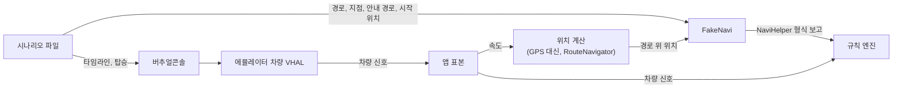

# 주행 시나리오

Nov 8, 2026

## 요약

시나리오는 에뮬레이터 시연에서 **실제 내비와 실제 주행을 대신하는 파일**이다. 실제 도로 경로(OSRM)에 가상 운전자 모델을 입혀 미리 시나리오 파일을 정의하고, 앱은 그 파일을 읽어 경로는 FakeNavi에, 주행 타임라인은 버추얼콘솔에 나눠 준다. 규칙 엔진은 시나리오를 직접 읽지 않으므로, 실차에서는 시나리오를 빼고 실제 내비와 실제 주행으로 바꾸면 된다. 생성기는 개발 PC에서만 실행하는 Node 스크립트이며 앱에 포함되지 않는다. 앱 빌드에는 생성 결과인 시나리오 파일만 들어간다.

| 위치 | 구성 | 구현 |
| --- | --- | --- |
| 개발 PC | 경로 원본 | `tools/scenario/routes/*.json` (OSRM 응답) |
| 개발 PC | 생성기 | `tools/scenario/from-route.mjs` (경로 변환과 운전자 모델), `projection.mjs` (지도 좌표), `validate.mjs` (검증), `common.mjs` (공통 한계값) |
| 앱 | 시나리오 파일 | `app/src/main/assets/scenarios/<id>.json` |
| 앱 | 앱에서 읽기 | `demo/ScenarioRepository`, `demo/Scenario` |
| 앱 | FakeNavi에 전달 | `demo/ScenarioRoute` → `nav/Guidance`, `nav/RouteNavigator`, `nav/FakeNaviHelper` |
| 앱 | 콘솔에 전달 | `demo/ScenarioPlayer` → `demo/ConsoleClient` |

## 1. 시나리오가 필요한 이유

### 1.1 기능을 보이려면 경로를 따라 달려야 한다

Active Seat For All의 핵심은 **곧 일어날 움직임을 미리 알리는 예측**이다. 턴 예측은 내비가 안내하는 다음 회전, 그 회전까지 남은 거리, 같은 쪽 방향지시등이 함께 맞아야 켜지고, 감속 예측은 과속 카메라나 방지턱까지 남은 거리와 지금 속도로 켜진다(HardwareControl 7.4, 7.5절). 즉 차가 내비 경로 위를 달리고, 남은 거리가 주행에 따라 줄어들고, 운전자가 그 경로에 맞게 핸들과 방향지시등과 속도를 조작해야 예측이 보인다. 조향과 속도만 보는 실측 모델은 경로 없이도 동작하지만, 그것만으로는 "미리 알린다"를 보여 줄 수 없다.

### 1.2 콘솔 수동 조작으로는 주행을 재현하기 어렵다

버추얼콘솔은 속도, 조향, 페달, 방향지시등을 손으로 하나씩 바꾸는 도구다.

- **동시에 맞출 수 없다.** 회전 하나를 재현하려면 회전 지점 30m 전에 방향지시등을 켜고, 약 1.2초 전부터 회전 반지름에 맞는 각도로 핸들을 꺾고, 코너 속도로 줄였다가 다시 가속해야 한다. 이 값들을 0.2초 단위로 서로 맞춰 손으로 움직일 수 없다.
- **경로 위 위치를 볼 수 없다.** 조작하는 사람은 차가 경로의 어디쯤인지 모르므로 회전 지점이나 카메라에 맞춰 조작할 수 없다.
- **반복할 수 없다.** 같은 주행을 두 번 만들 수 없어, 시연마다 결과가 달라지고 규칙 엔진 수치를 바꾼 전후를 비교할 수 없다. 시나리오는 같은 파일이면 같은 주행이라 단위 테스트(`ScenarioReplay`, `RerouteReplayTest`)에서도 그대로 재생한다.

### 1.3 수동 조작으로는 위치도 내비 정보도 바뀌지 않는다

에뮬레이터(Pleos_Connect v2.1.0, NaviHelper 3.0.5)에서 측정한 결과다.

| 상황 | 실제 NaviHelper가 보내는 것 |
| --- | --- |
| 목적지 없음 | 약 1초마다 `onCurrentRoadSpeedLimit(0)`만. TBT는 빈 목록, 현재 위치는 고정(37.4127212, 127.094681, 방위 0) |
| 목적지 설정 후 | TBT 9개를 한 번 보내고, 이후 콘솔로 60~80km/h를 달려도 값이 바뀌지 않음. 위치 고정. 과속 카메라, 주의 지점 보고 없음 |

콘솔은 차량 상태(VHAL)만 바꾸고 GPS 위치는 바꾸지 않는다. 그래서 내비는 차가 서 있다고 보고, 남은 거리가 줄지 않는 정적인 정보만 준다. 이 정보로는 예측이 켜질 수 없다.

> **이것이 시나리오와 함께 FakeNavi를 구현한 이유다.** 시나리오는 경로를 FakeNavi에 주고, FakeNavi가 차량 속도로 위치를 계산해 실시간으로 바뀌는 NaviHelper 형식의 보고를 만든다.

## 2. 시나리오의 역할

### 2.1 정의하는 것과 정의하지 않는 것

**정의하는 것**

| 항목 | 필드 | 내용 |
| --- | --- | --- |
| 식별과 표시 | `id`, `title`, `originRoad`, `mapImage`, `mapSize` | 즐겨찾기 이름, 출발 도로 이름, 지도 이미지와 크기(px) |
| 주행 경로 | `routePx`, `routeLengthM` | 지도 픽셀 좌표의 선, 길이(m) |
| 경로 위 지점 | `turns`, `frontEvents`, `cameras`, `cautionPoints` | 출발점에서의 거리(`atM`)와 NaviHelper 값 그대로의 종류. 회전, 정체, 과속 카메라, 주의 지점 |
| 안내 경로와 이탈 지점 | `plannedRoute` | 운전자가 따르지 않을 안내 경로와 두 경로가 갈라지는 거리. 이탈 시나리오만 |
| 주행 타임라인 | `timeline` | 0.2초마다 속도(km/h), 조향(도, 왼쪽 양수), 브레이크와 액셀(%), 방향지시등(`Off`, `BlinkLeft`, `BlinkRight`) |
| 탑승 | `occupiedSeats` | 사람이 앉은 콘솔 좌석|
| 시연 구간 | `demoWindow` | 재생할 타임라인 구간(초). 이 값이 없는 시나리오는 앱 목록에 나오지 않는다 |

**정의하지 않는 것**

| 항목 | 누가 정하나 |
| --- | --- |
| 시각별 차의 위치 | FakeNavi가 차량에서 읽은 속도를 적분해 계산한다. 조향은 위치에 영향이 없다 |
| NaviHelper 보고의 시점과 내용 | FakeNavi. 보고 주기 1초, TBT 2개, 카메라 600m, 주의 지점 300m 이내 |
| 재탐색 시간 | FakeNavi. 이탈 판정 2초, 재탐색 2초 |
| 기어 | 재생기가 출발 때 D로 쓴다 |
| 기대하는 힌트(정답) | 없다. 힌트는 규칙 엔진이 신호만 보고 판단한다 |
| 차량 제원 | 생성기 상수(조향비 14, 축간거리 2.9m)로 타임라인을 만들 때만 쓰고 파일에는 없다 |
| GPS 좌표, 방위, 신호등 상태, 주변 차량 | 없다 |

### 2.2 FakeNavi에 전달하는 것과 콘솔에 전달하는 것

시나리오의 정보는 둘로 갈라져 각각 다른 길로 앱에 들어간다. 어느 쪽도 규칙 엔진에 직접 가지 않는다.

**FakeNavi에 전달** (`AppViewModel`)

| 시점 | 전달 | 변환 |
| --- | --- | --- |
| 목적지 선택 | 주행 경로: `routePx`, 회전, 정체, 카메라, 주의 지점 | `toNavRoute`. 경로 길이는 `routeLengthM`이 아니라 **타임라인을 적분한 거리**로 쓴다. 지점 거리가 같은 척도로 만들어져 있어, 이렇게 해야 회전이 선의 꼭짓점에 놓이고 타임라인 끝에서 도착한다 |
| 목적지 선택 | 안내 경로와 이탈 지점 | `toPlannedRoute`. 안내 경로의 길이는 `plannedRoute.routeLengthM`. 카메라, 주의 지점, 정체는 주행 경로의 것 중 이탈 지점 이전 것만 가져간다 |
| 출발 | 시작 위치 | 시연 구간 시작 시각까지 타임라인을 적분한 거리(`distanceAtM`) |

FakeNavi는 타임라인을 받지 않는다. 위치는 앱이 차량에서 읽은 속도로 계산하므로, 실제 내비가 GPS로 위치를 아는 것과 같은 자리에 들어간다.

**콘솔에 전달** (`ScenarioPlayer`, 콘솔 HTTP API)

| 시점 | 쓰는 값 |
| --- | --- |
| 출발 | 3초 동안 세션 유지 신호만 보낸 뒤 기어 D. `occupiedSeats`의 좌석은 점유, 나머지 좌석은 빈 자리 |
| 0.2초마다 | 그 시각의 속도, 액셀, 브레이크, 조향(부호를 뒤집어 오른쪽 양수로). 방향지시등은 바뀔 때만. 행 사이 값은 선형 보간, 방향지시등은 앞 행 값 |
| 재생 중 0.8초마다 | 세션 유지 신호 |
| 종료(취소 포함) | 속도, 페달, 조향 0과 방향지시등 끔. 1초 더 세션을 유지해 0이 차량에 닿게 한다 |

- 속도는 콘솔에 **직접** 쓴다. 페달 값은 속도 변화에 어울리게 만든 값일 뿐 속도를 만들지 않는다. 앱은 브레이크를 눌림 여부로만 읽고 액셀은 읽지 않는다.
- 늦어지면 프레임을 건너뛰어 0.2초 격자를 지킨다. 타임라인을 늘이지 않으므로 FakeNavi의 위치와 타임라인의 거리가 어긋나지 않는다.

### 2.3 실제 주행에서 시나리오를 대체하는 방법

시나리오, 재생기, FakeNavi를 빼고 각 정보의 실제 출처로 바꾼다.

| 시나리오가 대신하는 것 | 실차에서의 출처 | 빠지는 코드 |
| --- | --- | --- |
| 경로와 경로 위 지점 | 운전자가 실제 내비에 목적지를 넣는다. 실제 NaviHelper가 TBT, 과속 카메라, 주의 지점을 보낸다 | `ScenarioRoute`, `Guidance`, `FakeNaviHelper` |
| 위치 | 실제 내비가 GPS로 계산한다 | `RouteNavigator` |
| 이탈과 재탐색 | 실제 내비가 판단하고 `onReRouteEnded`를 보낸다 | `Guidance`의 재탐색 단계 |
| 주행 타임라인 | 실제 주행이 차량 상태를 바꾼다 | `ScenarioPlayer`, `ConsoleClient` |
| 탑승 | 실제 좌석 센서 | 재생기의 좌석 쓰기 |
| 시연 구간, 지도 | 필요 없다. 지도는 실제 내비 화면 | 앱의 데모 내비 화면 |

그대로 남는 것은 `CarSignalSource`, `SignalSampler`, `NaviFeed`, `MotionEngine`, `toHardwareCommand`다. `NaviFeed`를 FakeNavi 대신 실제 `NaviHelper`에 리스너로 등록하면 된다. 아직 연결하지 않았다.

**바꾸기 전에 확인할 것**

- **TBT 거리의 뜻.** FakeNavi는 `distance`를 차에서 회전 지점까지의 거리로 보낸다. 1.3절 측정에서 실제 TBT 9개의 `distance`(700, 50, 110, 40, 10000, 450, 1500, 330, 0)는 합이 경로 전체 길이(약 13km)와 비슷해, 회전 사이 구간 길이일 가능성이 있다. 그렇다면 첫 항목 외에는 앞 항목들을 더해야 남은 거리가 된다. 실차 주행에서 거리가 줄어드는지 확인해야 한다.
- **보고 주기와 범위.** 1초 주기, TBT 개수, 카메라와 주의 지점 범위, `isOverSpeed`의 뜻은 FakeNavi의 가정이다(HardwareControl 6.1절).
- **회전 종류.** 생성기는 `TurnType` 16개 안에서만 만든다(3.3절). 실제 내비는 44개 중 무엇이든 보낼 수 있다.

## 3. 경로 정의

### 3.1 원본

경로는 OSRM 공개 데모 서버의 응답을 그대로 저장한 파일이다(© OpenStreetMap contributors, ODbL). 출발점과 도착점 두 지점의 경로 하나다. 응답을 받아 오는 스크립트는 저장소에 없다.

| 사용하는 필드 | 용도 |
| --- | --- |
| `geometry.coordinates` | 경로 선(경도, 위도) |
| `legs[0].annotation.distance`, `speed` | 꼭짓점 사이 길이와 OSRM이 계산한 구간 속도. 구간 속도가 운전자의 자유 주행 속도가 된다(4.1절) |
| `legs[0].steps` | 기동 종류(`type`), 방향(`modifier`), 위치, 도로 이름(`name`), 방면(`destinations`), 구간 길이와 시간 |

경로 목록은 `from-route.mjs`의 `ROUTES`다.

| id | 제목 | 길이 | 재생 | 비고 |
| --- | --- | --- | --- | --- |
| `gangnam-pangyo` | 판교 | 15,616m | 150초 구간 | 긴 경로 |
| `gangnam-teheran` | 강남 테헤란로 | 834m | 전체 96초 | |
| `pangyo-dongpangyo` | 판교 동판교로 | 915m | 전체 101초 | |
| `seocho-jungang` | 서초 서초중앙로 | 958m | 전체 103초 | |
| `seoulstation-cheongpa` | 서울역 청파로 | 1,050m | 전체 108초 | |
| `seohyeon-yanghyeon` | 서현 양현로 | 1,178m | 전체 109초 | 이탈 시나리오 |

`smoke.json`은 손으로 쓴 테스트용 파일이며 `demoWindow`가 없어 앱 목록에 나오지 않는다.

### 3.2 거리와 지도 좌표

- **거리**: 모든 지점은 출발점에서 경로를 따라 잰 거리(`atM`, m)로 위치를 가진다. 꼭짓점의 거리는 `annotation.distance`의 누적합이다.
- **지도 좌표**: 웹 메르카토르, 줌 15 고정(모든 경로 같은 축척), 경로 둘레 여백 900px. 지도 렌더러(`tools/map/render.mjs`)와 같은 투영을 써서 선이 지도에 정확히 놓인다.
- **선 단순화**: 미터 단위 Douglas-Peucker. 허용 오차 0.1px에서 시작해 점이 399개를 넘을 때만 키운다. 회전 꼭짓점은 항상 남겨 회전이 선의 모서리에 놓이게 한다. 곡선을 깎으면 거리 비율이 틀어지므로 오차를 픽셀 이하로 둔다.

### 3.3 회전 안내

OSRM 기동 중 내비가 안내할 만한 것만 회전으로 만든다. 출발(`depart`), 도로 이름만 바뀜(`new name`), 알림(`notification`), 직진 계속(`continue` + `straight`)은 뺀다.

| OSRM | `TurnType` |
| --- | --- |
| `left`, `right` | `TURN_LEFT`, `TURN_RIGHT` |
| `slight left`, `slight right` | `TURN_KEEP_L`, `TURN_KEEP_R` |
| `sharp left`, `sharp right` | `TURN_SHARP_L`, `TURN_SHARP_R` |
| `uturn` | `TURN_UTURN` |
| `straight` | `TURN_STRAIGHT` |
| `on ramp`, `off ramp` | `TURN_ENTER_IC_L/R/C`, `TURN_EXIT_IC_L/R/C` |
| `arrive` | `TURN_ARRIVE` |
| 그 밖 | `TURN_UNKNOWN` |

OSRM에는 터널, 톨게이트, 휴게소에 해당하는 값이 없어 합류와 분기는 운전자에게 요구하는 차로 유지 방향으로 읽는다. 설명은 `<도로 이름> 방면`, 이름이 없으면 `<방면> 방면`, 둘 다 없으면 `IC 방면` 또는 `경로 안내`, 도착은 `<제목> 도착`이다.

**도로 등급**: OSRM 응답에 도로 등급이 없어, 그 구간의 OSRM 평균 속도가 70km/h 이상이면 자동차 전용도로로, 아니면 도심 도로로 본다. 제한 속도, 방향지시등 거리, 신호등 후보, 주의 지점 배치가 이 구분을 따른다.

### 3.4 경로 위 지점

과속 카메라, 주의 지점, 정체는 OSRM에 없어 생성기가 배치한다. 위치는 실제 도로 시설이 아니다. 경로 길이가 1,500m 이하인 짧은 경로는 시연 150초 안에 모든 상황이 들어가도록 규칙으로 놓고, 긴 경로는 시나리오 id로 시드를 고정한 난수(포아송 과정)로 놓는다. 운전자가 각 지점에서 어떻게 달리는지는 4.4절에서 다룬다.

| 지점 | 종류 | 긴 경로 | 짧은 경로 |
| --- | --- | --- | --- |
| 과속 카메라 | `SPEED_CAMERA_FIX`. 제한 속도 도심 50, 자동차도로 100km/h | km당 0.3개 | 두 번째로 긴 직선 끝 부근에 1개 |
| 방지턱 | `SPEED_BUMP` | 도심 도로만. km당 0.2개 | 세 번째로 긴 직선 가운데에 1개. 그 앞에서 35km/h보다 빠를 때만 |
| 어린이 보호구역 | `SCHOOL_ZONE`. `atM`이 구역 시작 | 도심 도로만. km당 0.05개 | 없음 |
| 정체 | `frontEvents`의 `CONGESTION`. 설명 `<도로> 정체 <길이>m, 평균 <속도>km/h` | 감속 구간의 절반에만 붙는다(4.4절) | 가장 긴 직선의 급제동 1개에 붙는다 |

직선은 안내되는 회전으로 경로를 자른 구간이다. 카메라와 주의 지점은 서로, 그리고 회전, 신호 정지, 정체 구간과 100m 이상 떨어뜨리고, 출발점과 도착점 300m 안에는 놓지 않는다(긴 경로).

### 3.5 이탈 시나리오의 안내 경로

`ROUTES` 항목에 `drivenFile`이 있으면 이탈 시나리오다. `file`은 내비가 안내하는 경로, `drivenFile`은 차가 실제로 달리는 경로다.

- 타임라인, 지점, `routePx`는 모두 **실제 주행 경로**로 만든다. 지도 범위만 안내 경로로 정해, 기존 지도 하나에 두 선이 다 들어가게 한다.
- `plannedRoute`에는 안내 경로의 `routePx`, `routeLengthM`, `turns`와 이탈 지점 `leaveAtM`을 넣는다.
- **이탈 지점**: 두 경로를 출발점에서 같은 거리씩 0.1m 간격으로 따라가며, 처음으로 3m 넘게 벌어진 곳을 찾고, 그 앞에서 두 선이 0.5m 이내로 붙어 있던 마지막 지점을 이탈 지점으로 한다.
- 검증기는 이탈 지점이 안내 경로의 첫 회전에서 15m 이내인지, 운전자가 그 회전 150m 전부터 그 방향 방향지시등을 켜지 않는지 확인한다. 놓친 회전에 신호를 켜면 턴 예측이 켜져 이탈이 아니게 되기 때문이다.

## 4. 운전자 주행 모델

### 4.1 원칙

- **모든 경로가 같은 코드와 같은 상수를 쓴다.** 경로 id로 달라지는 것은 `ROUTES`의 파일과 제목, 난수 시드뿐이다. 경로별 파라미터를 두지 않는다.
- **예측 결과를 보고 상수를 맞추지 않는다.** 생성기 상수는 규칙 엔진과 무관하게 정했다. 규칙 엔진의 threshold는 이 시나리오를 재생해 맞출 수 있지만, 그 반대는 하지 않는다.
- **결정적이다.** 난수는 시나리오 id로 시드를 정한다(FNV-1a, mulberry32). 신호 정지, 정체, 카메라, 주의 지점, 조향 오차가 각자의 시드를 써서, 규칙 하나를 바꿔도 다른 항목의 배치가 섞이지 않는다.

### 4.2 곡률과 이상 조향

OSRM 선은 꼭짓점에서 꺾이는 꺾은선이라 그대로는 핸들 각도를 만들 수 없다.

1. 꼭짓점마다 방향 변화량을 구하고, 그 변화를 가우시안으로 펼쳐 1m 격자의 곡률로 만든다. 방향을 평균하지 않고 변화량을 펼치므로 회전 총량은 보존된다.
2. 가우시안 폭은 그 꼭짓점을 지나는 속도 × 1.2초(6~60m)다. 운전자가 꼭짓점을 그만큼의 주행 시간에 걸쳐 돌아 나간다고 본다. 느리게 도는 교차로는 좁게, 빠른 도로의 디지타이징 꺾임은 넓게 퍼져 사라진다.
3. 폭은 속도에, 속도는 곡률에 달려 있어 6번 반복한다.
4. 출발과 도착 5m 안에서는 곡률을 0으로 줄인다.
5. 이상 조향 = `atan(축간거리 × 곡률) ÷ 라디안 × 조향비`, 최대 450°.

### 4.3 속도

1m 격자에서 목표 속도를 정하고 앞뒤로 가감속 한계를 적용한다.

| 단계 | 값 |
| --- | --- |
| 자유 주행 속도 | 구간의 OSRM 속도. 상한 130km/h, 짧은 경로는 50km/h |
| 코너 속도 상한 | `√(2 m/s² ÷ |곡률|)`. 횡가속도 2m/s²를 넘지 않는다 |
| 지점별 목표 속도 | 신호 정지, 정체, 카메라, 주의 지점(4.4절) |
| 가감속 | 가속 1.5m/s², 감속 2m/s². 지점마다 더 센 감속을 정할 수 있다 |
| 시간으로 변환 | 격자 한 칸 안에서 가속도 일정. 출발과 도착에서 2초 정지 |
| 저크 제한 | 속도를 1초 창으로 이동 평균. 정지 지점까지의 거리는 보존된다 |

### 4.4 지점과 돌발 상황

| 상황 | 운전자 동작 | 긴 경로 | 짧은 경로 |
| --- | --- | --- | --- |
| 신호 정지 | 회전 지점 15m 앞 정지선에서 멈춰 10~40초 대기 | 도심의 실제 좌우 회전 교차로마다 50% 확률. 정지끼리 100m, 양 끝 60m 간격 | 없음 |
| 정체 감속 | 150~800m 구간을 자유 속도의 25~60%(최소 3m/s)로 | km당 0.3개. 절반은 `CONGESTION`이 붙고(구간 시작 20~150m 뒤), 그중 30%는 3.5~5m/s²로 급제동해 진입. 나머지 절반은 예고 없이 보통 감속 | 가장 긴 직선의 60% 지점에서 4.5m/s² 급제동, 자유 속도의 30%로 60m. `CONGESTION`은 30m 뒤 |
| 출발 | 1.5m/s²로 가속 | | 처음 40m를 3m/s²로 급출발 |
| 과속 카메라 | 절반은 카메라 250m 전부터 제한 + 15km/h로 과속하다 3m/s²로 제한 − 5km/h까지 감속, 나머지는 제한 이하로 통과. 카메라 뒤 30m까지 유지 | 절반 과속 | 항상 과속 |
| 방지턱 | 앞뒤 5m를 20km/h로. 2.5m/s²로 감속 | | |
| 어린이 보호구역 | 시작부터 300m를 30km/h로 | | 없음 |

- 제한 속도 이하로 지나는 카메라는 예측할 것이 없어, 과속 접근을 섞는다.
- 3.5m/s²보다 센 제동은 반드시 앞에 정체 예고가 있다. 예고 없는 감속은 그보다 약하게 둬서 "예측할 수 없는 정직한 경우"로 남긴다.
- 신호등 상태와 교통은 실제가 아니라 시드 고정 난수다.

### 4.5 핸들 잡기

운전자는 이상 조향을 그대로 따라 그리지 않는다. 0.02초 간격으로 다음을 시뮬레이션해 0.2초마다 기록한다.

| 요소 | 값 |
| --- | --- |
| 코너마다 이득 오차 | 이상 조향 15° 이상인 코너에 들어갈 때마다 0.92~1.08배 |
| 외란 | 노면 경사와 바람. 시간 상수 3초로 천천히 흔들리는 곡률, 표준편차 0.0005/m(핸들 약 1°) |
| 차선 확인 | 0.6~1.4초마다 이상 경로 대비 옆 위치와 방향을 본다. 0.2m 또는 1.5° 넘게 벗어났으면 2초(최소 8m) 앞에서 선으로 돌아오는 보정 각을 정한다 |
| 보정 한계 | 10° 또는 이상 조향의 15% 중 큰 값. 보정만으로 생기는 횡가속도는 0.5m/s² 이하. 보정 속도 20°/s |
| 조향 속도 | 190°/s 이하 |
| 정지 중 | 보정하지 않고 놓는다 |

보정은 15° 경계를 넘지 않는다. 직선에서는 15° 미만, 코너에서는 15° 이상에 머물러, 코너가 생기거나 사라지는 일은 도로 때문이지 운전자 때문이 아니다. 조향은 위치를 바꾸지 않으므로 이 흔들림은 지도 위 차를 움직이지 않는다.

### 4.6 방향지시등

| 항목 | 값 |
| --- | --- |
| 대상 | 안내되는 회전 중 방향이 좌우인 것(도착 제외) |
| 켜기 | 회전 지점 30m 전. 접근 구간이 자동차도로면 100m 전 |
| 끄기 | 회전 지점 10m 뒤부터 핸들이 5° 안으로 돌아오면. 늦어도 80m 뒤 |
| 겹칠 때 | 뒤 회전의 신호가 이긴다. 운전자는 이미 다음 회전을 준비한다 |

거리 기준이므로 몇 초 전에 켜지는지는 속도로 정해진다.

### 4.7 페달

속도 변화에 어울리게 만든 값이다(2.2절).

- **브레이크**: 감속이 0.6m/s²보다 크면 `12 × (감속 − 0.6)`%. 3km/h 아래에서는 멈춰 있기 위해 최대 30%. 약한 감속은 관성 주행이라 0.
- **액셀**: 정속 `(5 + 0.15 × km/h)`%에 가속 `18 × 가속도`%를 더한다. 브레이크를 밟는 동안 0.

### 4.8 한계

- 실제 사람의 운전 기록이 아니다. 반응 시간, 습관, 차선 변경, 주변 차량이 없다.
- 생성기의 가상 차와 규칙 엔진이 같은 자전거 모델과 제원(조향비 14, 축간거리 2.9m)을 쓴다. 그래서 시나리오에서 실측 모델의 횡가속도는 생성기가 의도한 값과 거의 같게 나오며, 실차의 오차를 보여 주지 못한다.
- 카메라, 주의 지점, 정체, 신호등은 실제 위치와 상태가 아니다.
- 그래서 시나리오로 맞춘 규칙 엔진 수치는 동작 확인용이며, 실제 값은 실차 주행 실험으로 정해야 한다(HardwareControl 7.2절).
