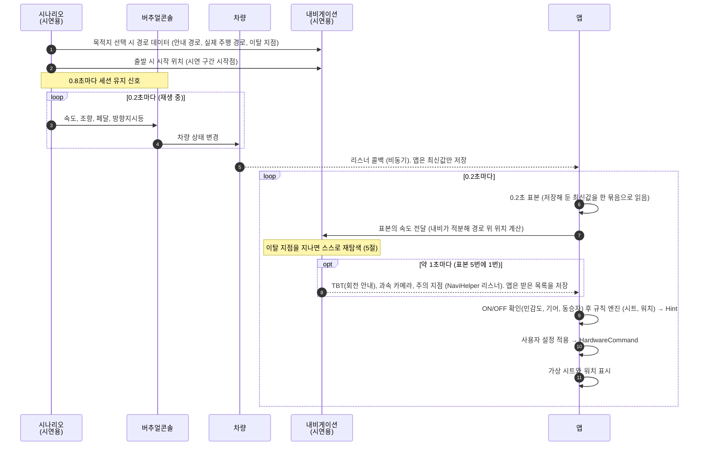
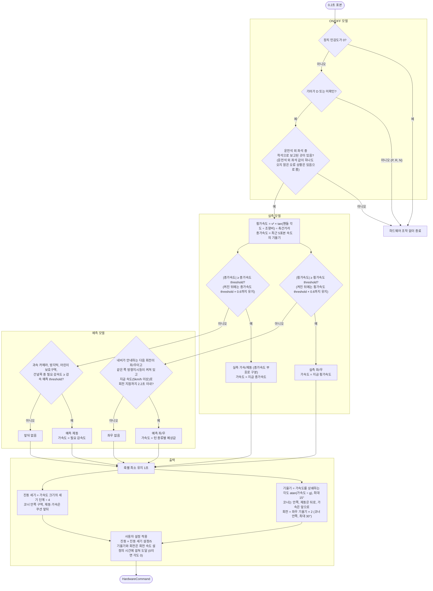

# 차량 정보 수집부터 하드웨어 조작까지

Nov 8, 2026

# 요약

0.2초마다 차량 신호를 한 번 읽고, 같은 순간의 내비 보고와 함께 기기 안의 규칙 엔진(`MotionEngine`)에 넣는다. 엔진은 축(좌우, 앞뒤)마다 **이미 일어나는 움직임(실측)**을 먼저 보고, 없으면 **곧 일어날 움직임(예측)**을 본다. 결과 `Hint`를 하드웨어 명령으로 바꾸고 사용자 설정을 적용해 화면의 가상 시트와 워치를 움직인다.

## 1. 정보 수집, 가공, 하드웨어 조작 시퀀스

| 참가자 | 구현 |
| --- | --- |
| 시나리오 | 시나리오 파일, `demo/ScenarioRepository`, `demo/ScenarioRoute`(경로 변환), `demo/ScenarioPlayer`, `demo/ConsoleClient` |
| 버추얼콘솔 | 에뮬레이터가 제공하는 차량 조작 도구. 이 저장소의 코드가 아니다 |
| 차량 | 에뮬레이터의 VHAL 또는 실차. 이 저장소의 코드가 아니다. 앱은 Android Car API와 Pleos Vehicle SDK로 읽는다(3절) |
| 내비게이션 | `nav/Guidance`, `nav/FakeNaviHelper`. 실제 내비를 대신한다 |
| 앱 | `vehicle/CarSignalSource`, `vehicle/SignalSampler`, `motion/NaviFeed`, `motion/MotionEngine`, `hardware/toHardwareCommand`, `ui/AppViewModel`, `ui/HardwarePanel` |

시나리오와 내비게이션도 앱 프로세스 안에서 돌지만, 실차에서 사라지는 시연용 부분이라 따로 그렸다.

- **내비 정보 수집 주기는 표본 수집 주기와 별도로 관리한다.** 내비 보고는 표본마다 오지 않는다. FakeNavi는 직전 보고에서 1초가 지난 표본에서만 보고한다. 실제 내비도 매초 보고한다고 가정한 값이다(6.1절). 보고가 없는 표본에서는 엔진이 저장된 마지막 목록을 쓰고, 그 목록의 거리에서 보고 이후 달린 거리를 빼서 쓴다(6.2절). 실차에서는 이 주기를 앱이 정하지 않고 NaviHelper가 보낼 때 받는다. 이 설계는 앱의 표본 수집 주기와 NaviHelper의 데이터 갱신 주기가 불일치해도 동작하도록 만들기 위한 스펙이다.
- 실차에서는 1, 2번 대신 운전자가 실제 내비에 목적지를 넣고, 3, 4번 대신 실제 주행이 차량 상태를 바꾸며, 7번 없이 실제 내비가 자체 위치로 안내한다. 앱이 받는 형식(5번 콜백, 8번 NaviHelper 리스너)은 같으므로 표본 이후 단계는 출처를 모른다.
- **수신은 콜백, 판단은 0.2초 표본이다.** 앱은 차량을 직접 조회하지 않는다. `CarSignalSource`가 리스너를 등록해 두면 콜백이 올 때마다 최신값 하나를 덮어쓴다(속도는 10Hz로 요청, 기어는 바뀔 때, 조향, 브레이크, 방향지시등, 좌석은 Vehicle SDK 리스너). `SignalSampler`는 0.2초 격자에서 그 최신값을 읽기만 한다. 그래서 두 표본 사이에 여러 번 바뀐 값은 마지막 것만 남는다. 콜백마다 판단하지 않고 고정 주기로 판단하는 이유는 두 가지다. 신호마다 콜백 시점과 빈도가 달라 한 순간의 묶음이 필요하다. 값이 그대로여도(정속 주행, 정지) 최소 유지 1초, 예측 만료 같은 시간 규칙은 계속 진행해야 한다.
- 6번부터 11번까지는 표본 하나 안에서 동기로 실행된다. 11번은 화면에 명령을 넘기는 데까지이고, 시트와 워치가 움직이는 모습은 화면 프레임마다 따로 그린다. 내비 보고(8번)는 같은 표본의 규칙 엔진(9번)보다 먼저 들어간다.

## 2. 하드웨어 조작 규칙

시트와 워치는 이 흐름을 각자의 민감도로 따로 돈다. ON/OFF 모델에서 종료하면 민감도가 0인 장치는 엔진이 없고, 기어가 P, R, N이거나 동승자가 없으면 엔진을 초기화한다(상세 설계 7.1절). 세 설정은 서로 독립이다. **민감도**는 켤지 말지만, **진동 세기**는 진동의 크기만, **회전 속도**는 기울기에 도달하는 시간만 정한다. 기울기 각도는 가속도에서 산술적으로 정해지며, 회전 속도나 민감도가 0이어서 기울이지 않을 때를 빼면 설정의 영향을 받지 않는다.

아래 표의 가속도 단위는 m/s²다.

**켜기 threshold**: 가속도 크기가 이 값 이상이면 힌트를 켠다. 민감도에 따라 바뀌는 값은 이것뿐이다.

| 민감도 | 횡가속도 threshold | 종가속도 threshold | 감속 예측 threshold |
| --- | --- | --- | --- |
| 1 (×2.0) | 1.6 | 2.0 | 2.6 |
| 2 (×1.4) | 1.12 | 1.4 | 1.82 |
| 3 (×1.0, 기본) | 0.8 | 1.0 | 1.3 |
| 4 (×0.7) | 0.56 | 0.7 | 0.91 |
| 5 (×0.5) | 0.4 | 0.5 | 0.65 |

**진동 세기 단계**: 켜진 힌트의 진동 세기를 가속도 크기로 정한다. 민감도와 무관하다. 진동 세기 설정이 여기에 곱해진다.

| 가속도 크기 | 세기 단계 | 진동 세기 |
| --- | --- | --- |
| 1.5 미만 | 1 | 0.25 |
| 1.5 이상 2.5 미만 | 2 | 0.5 |
| 2.5 이상 4.0 미만 | 3 | 0.75 |
| 4.0 이상 | 4 | 1.0 |

> **이 문서의 수치는 모두 임시값이다.** threshold, 진동 세기 구간, 유지 비율, 최소 유지 시간, 턴 예측 조건, 예상 횡가속도, 기울기 상한 등은 실험 근거 없이 정했다. 실제로는 실차 주행으로 얻은 실험 데이터를 바탕으로 정해야 한다(상세 설계 7.2절).

# 상세 설계

요약 1의 시퀀스 단계 순서로 서술한다. 각 절 제목 괄호 안의 번호가 시퀀스 다이어그램의 단계 번호다.

## 1. 경로 설정 (1, 2번)

시나리오는 시연에서 실제 내비와 실제 주행을 대신한다. 앱이 시나리오에서 받는 정보는 다음과 같다. 시나리오를 어떻게 만드는지는 별도 문서에서 다룬다.

| 정보 | 목적 | 활용 |
| --- | --- | --- |
| 주행 경로: 경로 좌표, 회전 지점, 과속 카메라, 주의 지점 | 실제 내비가 안내할 경로를 대신한다 | 내비가 경로 위 위치를 계산하고(5절) 이 위치를 기준으로 NaviHelper 형식의 보고를 만든다(6절) |
| 안내 경로와 이탈 지점 | 운전자가 안내를 따르지 않는 상황을 재현한다 | 이탈 지점 전까지는 안내 경로로 보고하고, 지난 뒤에는 재탐색한다(5절). 이 정보가 없으면 주행 경로를 끝까지 안내한다 |
| 시연 구간 | 긴 경로에서 일부만 시연한다 | 출발 위치와 재생 범위를 정한다. 전체 경로를 고르면 처음부터 끝까지 재생한다 |
| 주행 타임라인: 시각별 속도, 조향, 브레이크, 액셀, 방향지시등 | 차량 상태를 재현한다 | 재생기가 버추얼콘솔에 쓴다(2절) |
| 착석 좌석 | 동승자 유무를 재현한다 | 재생기가 버추얼콘솔에 쓴다(2절) |

규칙 엔진은 시나리오를 직접 읽지 않는다. 경로 정보는 내비 보고로, 타임라인과 착석 정보는 차량 신호로 바뀐 뒤에만 엔진에 들어간다. 그래서 출처를 실제 내비와 실차로 바꿔도 엔진은 그대로다.

시나리오가 내비에 경로를 넘기는 시점은 두 번뿐이고, 주행 중에는 시나리오가 내비에 명령을 보내지 않는다. 주행 중 내비가 받는 것은 앱이 표본마다 넘기는 속도(5절)뿐이다.

| 시점 | 코드 | 동작 |
| --- | --- | --- |
| 목적지 선택 | `AppViewModel.select` → `place` | 주행 경로, 안내 경로, 이탈 지점으로 내비(`Guidance`, `FakeNaviHelper`)를 새로 만든다. 이전 내비 보고는 지운다. 앱이 시나리오를 처음 불러올 때도 첫 시연 경로로 `place`가 한 번 실행된다 |
| 출발 | `AppViewModel.start` | 내비의 시작 위치를 시연 구간 시작점(전체 경로면 0m)으로 맞추고 재생을 시작한다 |

## 2. 차량 상태 변경 (3, 4번)

재생기(`demo/ScenarioPlayer`)가 타임라인과 착석 정보를 버추얼콘솔의 HTTP API로 쓰고, 콘솔이 에뮬레이터의 차량 상태를 바꾼다.

| 시점 | 쓰는 값 |
| --- | --- |
| 출발 후 3초 | 기어 D. 시나리오에 착석 좌석이 있으면 콘솔 좌석 4개(운전석, 동승석, 뒷좌석 좌우) 중 착석 좌석을 점유로, 나머지를 빈 자리로 |
| 그 뒤 0.2초마다 | 그 시각의 속도(km/h), 액셀·브레이크(%), 조향(도). 모두 정수로 반올림한다. 방향지시등은 바뀔 때만 |
| 종료 | 속도, 페달, 조향 0과 방향지시등 끔 |

출발 후 3초는 콘솔이 차량 연결을 준비하는 시간이다. 그동안 내비의 시작 위치는 이미 정해져 있고 차는 서 있다.

- 조향은 쓸 때 부호를 뒤집는다. 시나리오와 SDK는 왼쪽 양수, 콘솔은 오른쪽 양수다.
- 재생하는 동안(준비 3초와 종료 후 1초 포함) 0.8초마다 세션 유지 신호를 보낸다. 콘솔은 이 신호가 3초간 없으면 차량 연결을 내린다.

## 3. 차량 신호 수신 (5번)

`vehicle/CarSignalSource`가 리스너를 등록해 두고, 콜백이 올 때마다 최신 상태(`VehicleSignal`) 하나를 덮어쓴다. 에뮬레이터와 실차에서 같은 API를 쓴다.

| 신호 | 출처 | 수신 | 변환 |
| --- | --- | --- | --- |
| 속도 | `CarPropertyManager` `PERF_VEHICLE_SPEED` | 10Hz 요청 | m/s × 3.6 → km/h |
| 기어 | `CarPropertyManager` `GEAR_SELECTION` | 변경 시 | P, R, N, D. 수동 1~9단은 D. 그 밖은 미확인 |
| 조향 | Vehicle SDK `SteeringWheelAngleListener` | SDK 리스너 | 도. 왼쪽 양수 |
| 브레이크 | Vehicle SDK `BrakePedalStatusListener` | SDK 리스너 | 눌림 여부 |
| 방향지시등 | Vehicle SDK `TurnSignalStateListener` | SDK 리스너 | 끔, 왼쪽, 오른쪽 |
| 좌석 점유 | Vehicle SDK `SeatOccupancyListener`, 좌석 6개 각각 | SDK 리스너 | **값을 뒤집는다**. SDK 2.3.2가 에뮬레이터에서 반대로 보고한다 |

- **페달은 판단에 쓰지 않는다.** 브레이크 페달은 받지만 규칙 엔진이 쓰지 않고, 액셀 페달은 SDK로 읽을 방법도 없다. 가속도를 직접 잴 수 있어 페달로 추정할 필요가 없다. 페달을 밟는 순간은 이미 가속이나 감속이 시작되는 때라 예측 모델에 쓸 수 없고, 실측 모델에서는 속도로 구한 가속도가 페달보다 믿을 만하다.
- 속도는 런타임 권한 `android.car.permission.CAR_SPEED`가 있어야 받는다. 없으면 등록을 시도하지 않고 화면에 "속도 없음"을 표시한다.
- SDK 리스너는 초기화 직후 등록하면 동작하지 않아 1.5초 뒤 등록한다.

## 4. 0.2초 표본 (6번)

`vehicle/SignalSampler`가 0.2초 고정 격자에서 3절의 최신 상태를 읽는다. 지연이 생기면 격자를 건너뛰어 다시 맞추고, 늘어지지 않는다. 두 표본 사이에 여러 번 바뀐 값은 마지막 것만 남는다.

표본 하나가 7~11번을 동기로 한 번 돌린다(`AppViewModel`). 순서는 위치 계산(7번), 내비 보고(8번), 규칙 엔진(9번), 하드웨어 명령(10번), 표시(11번)다. 그래서 내비 보고는 같은 표본의 규칙 엔진보다 먼저 들어간다.

## 5. 내비 위치 계산과 재탐색 (7번)

에뮬레이터에서는 주행해도 위치가 갱신되지 않아, FakeNavi(`nav/RouteNavigator`, `nav/Guidance`)가 GPS를 대신한다.

- **위치**: 표본의 속도를 시간에 대해 사다리꼴 적분해 출발점에서 몇 m 왔는지 구한다. 조향은 위치에 영향이 없다. 표본 간격이 1초를 넘으면 그 사이 속도를 모르므로 현재 속도로 1초분만 더한다. 남은 거리 5m 이하를 도착으로 본다.
- **재탐색**: 안내 경로가 있는 시나리오만 해당한다.

| 단계 | 조건 | 내비 보고 |
| --- | --- | --- |
| 안내 중 | 시작 | 안내 경로 기준. 차가 이탈 지점을 지나면 안내 경로 위 진행은 이탈 지점에 멈춘다 |
| 안내 중(이탈 판정) | 이탈 지점 통과 후 2초 동안 | 그대로 안내 경로 |
| 재탐색 중 | 그 뒤 2초 동안 | TBT, 카메라, 주의 지점 모두 빈 목록 |
| 새 경로 안내 | 재탐색 2초 후 | 한 번 `onReRouteEnded` 후 실제 주행 경로 기준 |

- 출발 위치가 이미 이탈 지점을 지났으면 이탈 판정과 재탐색 없이 새 경로 안내로 시작한다.
- 단계는 표본마다 바뀌지만 보고는 1초마다 나가므로(6.1절), 새 경로 안내와 `onReRouteEnded`는 재탐색이 끝난 뒤 최대 1초 늦게 나간다.

2초 값은 임시값이다. 재탐색 중 실제 NaviHelper가 무엇을 보내는지는 모른다(SDK에는 완료 이벤트만 있다).

## 6. 내비 보고 (8번)

### 6.1 보고 발행 (`nav/FakeNaviHelper`, `AppViewModel`)

FakeNavi는 SDK의 리스너(`NaviHelperEventListener`)와 데이터 클래스를 그대로 써서 받는 쪽이 실제 내비와 구분할 수 없게 한다. 보고 시점은 `AppViewModel`이 정한다. 경로가 정해진 뒤 첫 표본에서 바로 보고하고, 그 뒤로는 직전 보고에서 1초가 지난 표본에서만 보고한다. 재생 전에도 경로가 정해져 있으면 보고한다.

| 항목 | 값 | 비고 |
| --- | --- | --- |
| 보고 주기 | 1초 | 실제 내비도 매초 보고한다고 가정한 임시값 |
| TBT 개수 | 앞의 2개 | 임시값 |
| 과속 카메라 범위 | 600m 이내 | 임시값 |
| 주의 지점 범위 | 300m 이내 | 임시값 |
| `isOverSpeed` | 현재 속도 > 제한 속도 | 의미 추정 |

TBT 개수, 범위, 필드 의미는 실제 내비와 대조하지 않았다. 실차에서는 이 주기를 앱이 정하지 않고 NaviHelper가 보낼 때 받는다.

### 6.2 보고 저장 (`motion/NaviFeed`)

`NaviFeed`는 리스너를 구현해 마지막 보고 세 가지를 들고 있다.

| 보고 | 규칙 엔진이 쓰는 값 | 규칙 엔진 사용 |
| --- | --- | --- |
| `onTBTInfo`: 앞으로 만날 회전 안내 목록 | 종류(`type`), 남은 거리(`distance`), 설명(`description`) | 첫 항목의 종류와 남은 거리로 턴 예측 |
| `onCameraAlert`: 과속 카메라 목록 | 식별자(`id`), 종류(`type`), 제한 속도(`speedLimit`), 남은 거리(`remainDistance`) | 종류로 과속 카메라를 고르고, 제한 속도와 남은 거리로 감속 예측 |
| `onCautionPointInfo`: 주의 지점 목록 | 식별자(`id`), 종류(`type`), 남은 거리(`remainDistance`) | 종류로 목표 속도를 정하고, 남은 거리로 감속 예측 |

필드 이름은 SDK 데이터 클래스에 정의된 그대로이며, 표에는 규칙 엔진이 쓰는 필드만 적었다. 과속 카메라는 이 밖에 상태, 구간 평균 속도, 과속 여부 등도 함께 온다. 거리는 TBT가 실수형, 카메라와 주의 지점이 정수형이다. SDK에 설명 문서가 없어 단위는 m로 추정한다. 식별자는 보고가 바뀌어도 같은 대상을 따라가고 소비 여부를 기록하는 데 쓴다.

보고의 거리는 도착 순간 기준이다. 규칙 엔진은 보고가 올 때의 자체 주행거리를 기억해, 보고가 없는 표본에서도 그 뒤 달린 거리를 빼서 남은 거리를 구한다. 목록 객체가 바뀌면 새 보고로 본다. 그래서 앱의 표본 주기와 내비의 보고 주기가 달라도 동작한다.

실제 `NaviHelper`에는 아직 연결하지 않았다. 실차에서는 같은 `NaviFeed`를 실제 `NaviHelper`에 등록하는 구조다.

## 7. 규칙 엔진 (9번)

`motion/MotionEngine`이 표본마다 차량 신호와 내비 보고로 축(좌우, 앞뒤)마다 힌트를 정한다. 시트와 워치가 엔진을 하나씩 따로 돌린다. 부호는 좌우와 조향이 왼쪽 양수, 앞뒤가 가속 양수다.

### 7.1 ON/OFF 모델

| 조건 | 처리 | 엔진 상태 |
| --- | --- | --- |
| 장치 민감도가 0 | 그 장치의 엔진을 만들지 않아 힌트가 없다 | 없음 |
| 기어가 P, R, N | 빈 출력을 낸다. 기어를 보고하지 못하는 차는 D로 보고 화면에 "기어 미확인"으로 표시한다 | 모두 지운다 |
| 운전석 외 착석 없음 | 빈 출력을 낸다 | 모두 지운다 |

기어와 착석은 엔진을 돌리기 전에 확인한다. 둘 중 하나라도 걸리면 엔진은 그 표본을 판단하지 않고 상태를 모두 지운다. 다시 D이고 동승자가 있으면 처음부터 시작한다. 그래서 다시 시작한 직후에는 종가속도 기울기가 0.2초 뒤부터 나오고, 내비 보고의 남은 거리는 다음 보고까지 최대 1초 동안 그 사이 달린 거리만큼 크게 잡힌다. 좌석 값이 깜빡이면 그때마다 초기화되어 진행 중인 힌트가 끊긴다.

착석 판단(`hasPassenger`)은 운전석을 뺀 좌석 중 하나라도 착석으로 보고되면 참, 보고된 좌석이 모두 빈 자리면 거짓이다. 일부만 보고되면 보고된 좌석만 본다. 운전석 외 좌석이 하나도 보고되지 않은 경우(센서 없음, 리스너 등록 실패)만 참으로 보고 "탑승 미확인"으로 표시한다. 시연에서는 재생기가 출발 때 시나리오의 착석 정보를 콘솔에 쓰므로 정상이라면 이 경우는 생기지 않는다.

### 7.2 설정값 (`motion/MotionConfig`)

모든 threshold와 상수는 `MotionConfig` 한 곳에 있다. 아래 값은 모두 실험 근거 없이 정한 임시값이다. 일부는 생성 시나리오를 재생해 맞췄지만, 시나리오 자체가 가상 운전자 모델이라 실제 차량과 사람의 반응을 대신하지 못한다. 실제 값은 실차 주행 실험으로 정해야 한다. 차량 가속도와 시트 반응을 함께 기록하고, 탑승자가 쏠림을 느끼는 시점과 힌트가 켜지는 시점, 체감 세기와 진동 세기를 비교해 정한다.

threshold 값은 민감도 3(배율 ×1.0) 기준이며, 다른 민감도의 값은 요약의 켜기 threshold 표를 따른다.

| 이름 | 값 | 뜻 |
| --- | --- | --- |
| `steeringRatio`, `wheelbaseM` | 14, 2.9m | 조향비와 축간거리. 시나리오 생성기의 가상 차와 같은 값이며 실차 제원으로 바꿔야 한다 |
| `slopeSamples` | 5 | 종가속도 기울기에 쓰는 속도 표본 수(0.8초) |
| `lateralOnMps2` | 0.8 | 횡가속도 threshold (민감도 3) |
| `brakeOnMps2`, `accelOnMps2` | 1.0, 1.0 | 종가속도 threshold (민감도 3). 코드에는 제동과 가속이 따로 있고 지금은 같은 값이다 |
| `offRatio` | 0.6 | 켜진 실측은 threshold의 60%까지 유지 |
| `levelBoundsMps2` | 1.5, 2.5, 4.0 | 진동 세기 2, 3, 4단계 시작. 민감도와 무관 |
| `sharpTurnMps2`, `turnMps2`, `gentleTurnMps2` | 3.0, 2.0, 1.0 | 턴 예측의 예상 횡가속도(7.4절 표) |
| `leadSec` + `approachSec` | 1.0 + 1.2초 | 회전 지점 도달 2.2초 전에 예측 시작 |
| `minSpeedKph` | 5km/h | 이보다 느리면 턴 예측 안 함 |
| `requiredDecelMps2` | 1.3 | 감속 예측 threshold (민감도 3) |
| `speedMarginKph` | 3km/h | 목표 속도 + 3 이하면 줄일 것이 없음 |
| `bumpKph`, `schoolZoneKph` | 20, 30km/h | 방지턱, 어린이 보호구역 목표 속도. 건널목은 0 |
| `graceMs` | 0.5초 | 지점을 지난 뒤 움직임을 기다리는 시간 |
| `maxPredictMs` | 8초 | 움직임 없이 예측이 켜져 있을 수 있는 최대 시간 |
| `newTurnJumpM` | 20m | 같은 턴이 이만큼 멀어져 다시 보고되면 새 턴 |
| `minHoldMs` | 1초 | 출력 최소 유지 |

### 7.3 실측 모델

- **횡가속도**: `v² × tan(핸들 각도 ÷ 조향비) ÷ 축간거리` (운동학 자전거 모델). 핸들 각도를 조향비로 나누면 앞바퀴 각도 δ다. 차의 회전 반지름은 `축간거리 ÷ tan δ`이고, 원운동의 구심 가속도 `v² ÷ 반지름`에 넣으면 이 식이 된다. v는 m/s다. 예를 들어 현재 임시값(조향비 14, 축간거리 2.9m)으로 50km/h에서 핸들 30°면 약 2.5 m/s²다. 타이어 미끄러짐을 무시한 저속 기하라 고속에서 크게 나올 수 있다.
- **종가속도**: 최근 5개 속도의 실제 시각 기준 최소제곱 기울기. 양수면 가속, 음수면 제동이다.
- **켜고 끄기**: 크기가 그 방향 threshold 이상이면 켠다. 켜진 뒤에는 같은 부호이고 threshold × 0.6 이상인 동안 유지한다. 값이 threshold 근처에서 오르내릴 때 깜빡이지 않게 하기 위해서다.
- **출력 가속도**: 켜져 있는 동안 표본마다 지금 가속도를 그대로 내보낸다. 기울기와 진동 세기는 이 값으로 정한다(8.2절). 실측이 꺼진 뒤 최소 유지 1초 동안에는 마지막 가속도를 유지한다(7.6절).

### 7.4 턴 예측 (좌우)

실측이 threshold 미만일 때, 다음을 **모두** 만족하면 켠다.

1. TBT 첫 항목이 좌우 방향이 있는 턴이다(아래 턴 종류 분류).
2. 방향지시등이 같은 방향이다.
3. 속도 5km/h 이상, 남은 거리 > 0.
4. 남은 거리 ÷ 속도 ≤ 2.2초. 운전자가 회전 지점 약 1.2초 전부터 핸들을 꺾는다고 보고, 힌트는 그보다 1초 먼저 켠다. 예를 들어 36km/h(10m/s)면 회전 지점 22m 앞에서 켜진다.
5. 이 턴이 아직 소비되지 않았다.

출력 가속도는 턴 종류별 예상 횡가속도다. 아직 핸들을 꺾지 않아 횡가속도를 잴 수 없고, 회전 안내에는 회전 반지름이 없으며 회전할 때의 속도도 지금 속도와 달라 계산할 수 없기 때문이다. 아래 값은 실험 근거 없이 정한 **임시값**이다.

| 턴 종류 | 예상 횡가속도 (m/s²) | 진동 세기 단계 |
| --- | --- | --- |
| 급회전(`TURN_SHARP_L`, `TURN_SHARP_R`), 유턴(`TURN_UTURN`) | 3.0 | 3 |
| 일반 좌우회전(`TURN_LEFT`, `TURN_RIGHT`) | 2.0 | 2 |
| 그 밖(차로 유지 `TURN_KEEP_*`, IC 진입·진출 `TURN_ENTER_IC_*`, `TURN_EXIT_IC_*`) | 1.0 | 1 |

이 값은 핸들을 꺾기 전에만 쓰인다. 실측 횡가속도가 threshold를 넘으면 예측은 소비되고 실측 값이 기울기와 진동을 정한다.

**턴 종류 분류**: 턴 종류는 NaviHelper SDK의 `TurnType` 값(43개) 그대로다. SDK에는 값 이름만 있고 뜻을 설명한 문서가 없어, 아래 분류는 이름으로 판단한 임시 분류다.

| 분류 | `TurnType` 값 |
| --- | --- |
| 왼쪽 | `TURN_LEFT`, `TURN_SHARP_L`, `TURN_UTURN`, `TURN_KEEP_L`, `TURN_ENTER_IC_L`, `TURN_EXIT_IC_L` |
| 오른쪽 | `TURN_RIGHT`, `TURN_SHARP_R`, `TURN_KEEP_R`, `TURN_ENTER_IC_R`, `TURN_EXIT_IC_R` |
| 방향이 있지만 제외 | `TURN_ENTER_UNDER_L`, `TURN_ENTER_UNDER_R`, `TURN_AVOID_UNDER_L`, `TURN_AVOID_UNDER_R`, `TURN_ENTER_OVER_L`, `TURN_ENTER_OVER_R`, `TURN_AVOID_OVER_L`, `TURN_AVOID_OVER_R`, `TURN_ENTER_ROUNDABOUT_02`~`_12`, `TURN_EXIT_ROUNDABOUT` |
| 방향 없음 | 직진, 도착, 가운데(`_C`), 분기·합류, 톨게이트, 터널, 휴게소 등 나머지 |

유턴은 한국 도로 기준으로 왼쪽에 넣었다. 방향이 있지만 제외한 값은 다음 이유로 예측하지 않는다.

- **지하차도·고가도로 진입과 회피**(`TURN_ENTER_UNDER_*`, `TURN_AVOID_UNDER_*`, `TURN_ENTER_OVER_*`, `TURN_AVOID_OVER_*`): 이름의 좌우가 핸들을 꺾는 회전인지, 차로만 고르는 것인지 알 수 없다. 차로 선택이라면 쏠림이 거의 없어 예측하면 헛켜짐이 된다.
- **회전교차로 진입**(`TURN_ENTER_ROUNDABOUT_02`~`_12`): 방향이 좌우가 아니라 시계 방향의 출구 위치로 표현되고, 교차로 안에서 좌우로 여러 번 쏠린다. 한 방향의 쏠림으로 예측할 수 없다.
- **회전교차로 진출**(`TURN_EXIT_ROUNDABOUT`): 이름에 방향이 없다.

제외한 값의 회전도 실제로 핸들을 꺾으면 실측 모델이 잡는다. 실제 내비가 어떤 상황에서 어떤 값을 보내는지 확인하면 분류를 다시 정해야 한다.

**턴 식별**: 같은 회전에 예측이 두 번 켜지지 않게, 지금 보고된 회전이 이미 소비한 회전과 같은지 구분한다. 내비는 회전 지점을 지난 뒤에도 잠깐 같은 회전을 보고할 수 있는데, 회전 안내에는 회전마다 붙는 고유 번호가 없어 앱이 직접 식별한다.

- **키**: 종류와 설명을 이어 붙인 문자열이다(예: `TURN_RIGHT|한강대로77길 방면`). 다음 회전의 키가 바뀌면 새 회전이다.
- **같은 키의 새 회전**: 종류와 설명이 같은 회전이 연달아 나오면 키만으로는 구분할 수 없다. 같은 회전에 다가가는 동안 남은 거리는 줄어들기만 하므로, 직전보다 20m 넘게 늘어나면 앞 회전을 지나 다음 회전이 보고된 것으로 보고 새 회전으로 센다.
- **20m 여유**: 엔진은 보고 사이에 남은 거리를 자체 주행거리로 줄여 두다가, 새 보고가 오면 내비가 준 거리로 다시 맞춘다. 이때 두 값의 차이로 남은 거리가 조금 늘어날 수 있어, 이를 새 회전으로 오인하지 않게 여유를 둔다.
- **한계**: 이름이 같은 회전이 20m보다 가깝게 연달아 있으면 두 번째 회전을 예측하지 않는다. 핸들을 꺾으면 실측 모델은 잡는다.

**끄기**

| 상황 | 결과 |
| --- | --- |
| 좌우 실측이 켜짐(방향 무관) | 소비. 실측이 확인하거나 뒤집은 것 |
| 키가 바뀌거나 남은 거리 ≤ 0 후 0.5초 | 소비 |
| 켜진 지 8초 | 소비 |
| 지점 도달 전에 속도 5km/h 미만 또는 방향지시등이 꺼지거나 바뀜 | 해제. 소비하지 않아 조건이 다시 맞으면 켜진다 |

소비된 턴은 내비가 다음 턴을 보고할 때까지 다시 켜지지 않는다. 재탐색 중에는 TBT가 비어 예측이 켜지지 않고, 놓친 턴은 방향지시등이 없어 예측하지 않는다.

### 7.5 감속 예측 (앞뒤)

**대상과 목표 속도**: 대상은 종류로 고르고, 목표 속도는 종류로 정한다(과속 카메라는 보고의 제한 속도). 남은 거리는 대상마다 보고에서 받는다.

| 대상 | 목표 속도 |
| --- | --- |
| 과속 카메라 7종(`SPEED_CAMERA_FIX`, `_MOV`, `_TRAFFIC_LIGHT`, `_SCHOOL_ZONE`, `_SCHOOL_ZONE_TRAFFIC_LIGHT`, `VARIABLE_SPEED_CAMERA`, `SPEED_CAMERA_SECTION_START`) | 카메라 제한 속도 |
| `SPEED_BUMP` | 20km/h |
| `SCHOOL_ZONE` | 30km/h |
| `RAILROAD_CROSSING` | 0 |

운전자는 과속 카메라나 방지턱 앞에서 목표 속도까지 속도를 줄인다. 감속 예측은 "지금 속도로 그 지점까지 가면서 목표 속도로 줄이려면 얼마나 세게 감속해야 하나"를 계산해, 그 값이 크면 제동이 곧 온다고 본다. 실측 종가속도가 threshold 미만일 때 표본마다 다음 순서로 판단한다.

1. **대상 고르기**: 내비가 보고한 대상 중 아직 앞에 있고(남은 거리 > 0), 이미 처리하지 않았으며(소비되지 않음), 지금 속도가 목표 속도 + 3km/h보다 빠른 것만 남긴다. 이미 목표 속도 근처라면 줄일 것이 없기 때문이다.
2. **필요 감속도 계산**: 대상마다 `(지금 속도² − 목표 속도²) ÷ (2 × 남은 거리)`를 구한다. 속도는 m/s다. 남은 거리 안에 목표 속도까지 고르게 줄인다고 할 때의 감속도이며, 가까울수록, 빠를수록 커진다.
3. **가장 급한 대상 선택**: 대상이 여럿이면 필요 감속도가 가장 큰 것을 고른다.
4. **켜기**: 그 값이 감속 예측 threshold 이상이면 제동 예측을 켠다. 출력 가속도는 이 필요 감속도이며, 기울기와 진동 세기를 정한다(8.2절).

예를 들어 60km/h로 제한 속도 50km/h인 과속 카메라에 다가가면, 50m 앞에서는 필요 감속도가 0.85 m/s²라 켜지지 않는다. 감속 예측 threshold가 1.3(민감도 3)이면 약 33m 앞에서 켜지고, 30m 앞에서는 1.41 m/s²다.

**끄기**: 앞뒤 실측이 켜지면 소비. 대상이 목록에서 사라지거나 지나친 뒤 0.5초면 소비. 8초 경과면 소비. 목표 + 3km/h까지 줄었으면 소비. 목록에서 사라진 대상은 소비 기록에서도 지운다(뒤에 있으므로 다시 나올 수 없다).

### 7.6 축 결정과 최소 유지

- 좌우: 실측 > 턴 예측 > 없음.
- 앞뒤: 실측 가속 또는 제동 > 감속 예측 > 없음. 가속은 실측으로만 나온다.
- 축마다 최소 유지를 거친다. 새 방향은 즉시 켜고 가속도도 즉시 바꾼다. 없음이 와도 같은 방향으로 켜진 지 1초가 지나야 끈다.
- 결과는 `Hint`(`hint/Hint.kt`)다. 축마다 방향, 진동 세기, 가속도를 담는다.

## 8. 하드웨어 명령 생성 (10번)

`hardware/toHardwareCommand`가 시트 힌트, 워치 힌트, 사용자 설정으로 명령 하나를 만든다.

### 8.1 형식 (`HardwareCommand`)

| 필드 | 내용 |
| --- | --- |
| `headrest`, `backrest`, `cushion` | 진동 4구역(좌, 우, 앞, 뒤, 0~1), `rollDeg`(왼쪽 양수), `pitchDeg`(앞 양수), `yawDeg`(왼쪽 양수). 각도는 실제 도 단위다 |
| `watchStrength` | 0~1. 워치는 모터가 하나라 방향 없이 진동 세기만 받는다 |
| `leanSec` | 새 자세의 95%에 닿는 시간. 기본 2초 |

### 8.2 각도와 진동

원칙은 **관성의 반대로 미리 기울인다**이다. 코너는 안쪽, 제동은 뒤, 가속은 앞이다. 각도와 진동은 서로 다른 값에서 나온다.

- **기울기 각도**: 가속도를 상쇄하는 각도 `atan(가속도 ÷ g)`다(g = 9.81 m/s²). 이 각도로 몸을 기울이면 중력의 옆 성분이 관성력과 맞선다. 민감도, 진동 세기와 무관하다. 예를 들어 횡가속도 0.8이면 4.7°, 2.5면 14.3°다.
- **진동 세기**: 가속도 크기의 세기 단계 ÷ 4(요약의 진동 세기 단계 표).

| 출력 | 값 |
| --- | --- |
| 기울기(roll) | 좌우 가속도의 상쇄 각도. 좌회전이면 왼쪽(+) |
| 앞뒤(pitch) | 앞뒤 가속도의 상쇄 각도. 가속이면 앞(+), 제동이면 뒤(−) |
| 회전(yaw) | roll × 2. 시선을 코너 안쪽으로 돌린다 |
| 각도 상한 | roll, pitch 15°, yaw 30° |
| 좌우 진동 | 코너 안쪽 구역에 진동 세기 |
| 앞뒤 진동 | 쿠션에만. 가속이면 앞, 제동이면 뒤에 진동 세기 |
| 워치 | 좌우와 앞뒤 진동 세기 중 큰 값 |

yaw 비율 2와 각도 상한은 임시값이다. 실제 시트의 가동 범위는 모른다. 세 모듈은 같은 각도를 받는다. 코너와 제동이 겹치면 둘 다 적용한다.

### 8.3 사용자 설정 적용

설정 5개는 기기에 저장하고 기본값은 모두 3이다.

| 설정 | 단계 | 적용 |
| --- | --- | --- |
| 시트 민감도 | 0~5 | 시트 엔진의 켜기 threshold에 배율 ×2.0, 1.4, 1.0, 0.7, 0.5를 곱한다. 0이면 시트 힌트 없음 |
| 시트 진동 | 0~5 | 세 모듈의 진동 세기 × 단계/5. 각도에는 영향 없음 |
| 회전 속도 | 0~5 | 목표 각도에 도달하는 시간 `leanSec` 8, 4, 2, 1, 0.5초. 각도 크기는 바꾸지 않는다. 0이면 각도를 0으로 두고 진동만 남긴다 |
| 워치 민감도 | 0~5 | 워치 엔진의 켜기 threshold에 시트 민감도와 같은 배율을 곱한다. 0이면 `watchStrength` 0 |
| 워치 진동 | 0~5 | 워치 진동 세기 × 단계/5 |

민감도 배율은 켜기 threshold인 `lateralOnMps2`, `brakeOnMps2`, `accelOnMps2`, `requiredDecelMps2`에만 곱한다. 둔한 민감도에서 켜지자마자 진동이 세게 나오는 것은 실제 가속도가 크기 때문이며, 진동이 세다고 느끼면 진동 세기 설정으로 낮춘다. 턴 예측의 시작 조건에는 가속도 threshold가 없어 민감도가 직접 영향을 주지 않는다. 다만 실측 횡가속도가 켜지는 시점은 민감도를 따르므로, 예측이 실측으로 넘어가는 시점은 민감도에 따라 달라진다.

설정을 바꾸면 두 가지가 함께 일어난다.

- 민감도를 바꾸면 그 장치의 엔진을 새 threshold로 다시 만든다. 켜져 있던 힌트와 예측 상태는 모두 사라지고 처음부터 판단한다.
- 어느 설정이든 바꾸면 화면의 시트와 워치를 즉시 원위치로 돌린 뒤 새 명령을 따른다.

## 9. 표시 (11번)

실제 하드웨어 대신 화면(`ui/HardwarePanel`, `ui/SeatModel`)에서 명령을 그린다.

- **자세**: 헤드레스트의 각도로 시트 전체를 한 몸으로 돌린다. 각도는 실제 상쇄 각도라 배율 없이 그린다. 기울기 게이지와 바닥 회전판은 각도 상한(15°, 30°)을 끝으로 한 비율로 그린다.
- **기울기 곡선**: 1차 지연 4단을 잇는다. 단마다 시간 상수 `leanSec ÷ 7.754`이며 `leanSec`에 95%에 닿는다. 천천히 출발해 중간에 빠르고 천천히 멈춘다.
- **진동**: 시간 상수 0.18초의 1차 지연으로 켜고 끈다. 진동 세기 설정을 곱한 진동 값이 클수록 파동 주기가 짧아지고(0일 때 2.6초, 1일 때 1.7초), 참여하는 점과 밀려나는 폭과 밝기가 커진다. 기본 설정(3, ×0.6)에서는 가장 센 진동도 주기가 약 2.06초다.
- **워치**: 방향 패턴 없이 진동 세기에 따라 1~3개의 고리가 고정 주기로 맥동한다.
- **표시 문구**: 진동 세기 설정을 곱하기 전의 진동 세기로 표시한다. 시트와 워치 힌트 중 진동 세기가 큰 쪽(같으면 시트)을 보여 준다. 제목은 "좌회전", "감속" 등이고, 두 축이 함께 켜지면 "좌회전 + 감속"처럼 잇는다. 앞뒤 진동 세기 단계가 3 이상(앞뒤 가속도 2.5 이상. 예측 제동이면 필요 감속도)이면 "감속", "가속" 대신 "급정거", "급출발"이다. 힌트가 없으면 "유지", 두 장치의 민감도가 모두 0이면 "힌트 꺼짐"이다. 제목 옆에는 두 축 중 큰 진동 세기를 "강도 N"(0~100)으로 표시한다. 전후좌우 막대는 해당 방향 힌트의 진동 세기(0.25~1.0)를 퍼센트로 보여 준다.
